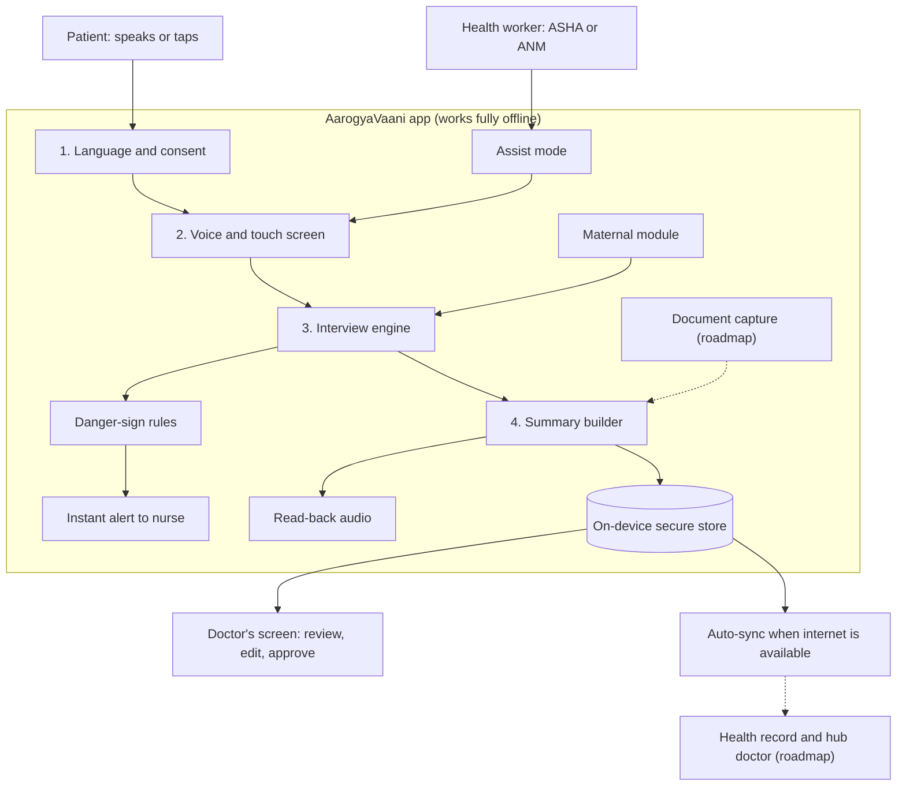

# AarogyaVaani

**A voice-first, offline patient intake tool for primary health centres.**

AarogyaVaani helps a patient, or an ASHA or ANM working with the patient, give a complete health history before the doctor consultation. It works by voice or by tapping pictures, in the patient's own language, with no internet needed. It warns the health team about danger signs, especially in pregnancy, and gives the doctor a short summary to review.

> **Status:** Hackathon prototype in progress. This is a research and demo project. It is not a medical device. It does not diagnose. A doctor reviews every summary.

**Hack for Social Cause, VBYLD 2027**
Theme: Healthcare, Wellbeing & Service Delivery
State focus: Tripura

---

## The problem

- In India, the average primary care consultation lasts about 2 minutes [1].
- In Tripura, 63.43% of people have Bengali as their mother tongue and 23.97% have Kokborok [3][4]. Nearly 1 in 4 rural women aged 15 to 49 are not literate [2].
- Only 52.7% of women in Tripura had four or more antenatal care visits. In Unakoti district it was 24.6% [2].
- About a third of medical officer and specialist posts are vacant [2].
- Patient history is on paper, so each visit starts from zero. A doctor joining by tele-consultation has no history to read.

Typing and reading are not options for many patients. Voice and pictures are.

## The solution

AarogyaVaani runs on an Android phone or tablet kept at the health centre.

1. The patient chooses a language and hears a short audio message about consent.
2. The app asks questions out loud. The patient answers by speaking or by tapping pictures. An ASHA or ANM can run the interview in assist mode.
3. The app asks follow-up questions the way a doctor would, and checks every answer for danger signs. An urgent sign sends an instant alert to the nurse.
4. The app builds a short, structured summary and reads it back to the patient.
5. The doctor reads, edits and approves the summary. Saved data syncs when the network returns.

It fits in front of eSanjeevani, the national telemedicine service, where a local health worker connects the patient to a hub doctor [5]. The summary gives that doctor the history before the call.

## Features

| No. | Feature | Phase |
|-----|---------|-------|
| 1 | Language and consent (audio explanation, voice or tap) | MVP |
| 2 | Voice-first intake (Bengali, Hindi) | MVP |
| 3 | Touch and icon answers | MVP |
| 4 | Adaptive follow-up questions | MVP |
| 5 | Danger-sign alerts | MVP |
| 6 | Maternal and antenatal module (flagship use case) | MVP |
| 7 | Health worker assist mode | MVP |
| 8 | Doctor summary (edit, approve, read-back to patient) | MVP |
| 9 | Offline use and auto-sync | MVP offline, sync on roadmap |
| 10 | Data protection and session cleanup | MVP |
| 11 | Document capture (old prescriptions, reports) | Roadmap |
| 12 | Health record (ABHA) and tele-consult link | Roadmap |

## Architecture



A consent and privacy layer wraps the whole flow. Nothing is recorded without agreement, and temporary session data is cleared after the summary is saved.

## Planned interface (API)

This is a design list. The same calls run on the device when the app is offline.

| Feature | Planned calls |
|---------|---------------|
| Language and consent | `POST /consents`, `DELETE /consents/{id}` |
| Voice and touch intake | `POST /sessions`, `POST /sessions/{id}/answers` |
| Adaptive follow-up questions | `GET /sessions/{id}/next-question` |
| Danger-sign alerts | `GET /sessions/{id}/alerts`, `POST /alerts/{id}/acknowledge` |
| Maternal module | `POST /sessions` with `module = maternal` |
| Assist mode | `POST /sessions` with `mode = assisted` |
| Doctor summary | `GET /sessions/{id}/summary`, `PUT /sessions/{id}/summary`, `POST /sessions/{id}/summary/approve`, `GET /sessions/{id}/summary/audio` |
| Offline use and auto-sync | `POST /sync`, `GET /sync/status` |
| Data protection and cleanup | `DELETE /sessions/{id}/temp-data` |
| Document capture (roadmap) | `POST /documents`, `GET /documents/{id}/extracted`, `GET /patients/{id}/timeline` |
| Record and tele-consult link (roadmap) | `POST /records/push`, `POST /teleconsult/handoff` |

## Safety and privacy

- The app gives no diagnosis. The doctor approves every summary.
- Danger-sign checks use fixed medical rules built from standard lists of pregnancy danger signs [6][7]. A doctor or senior nurse should review the final list before any real use.
- The app reads back what it heard so the patient can correct mistakes.
- Consent is asked first, in audio and in the local language. The patient can refuse or withdraw at any time.
- Consent follows India's Digital Personal Data Protection Act 2023.
- Temporary data, such as audio and answers in progress, is deleted once the summary is saved.

## MVP scope

What the demo will show:

- One use case: maternal and antenatal intake, with about 10 to 15 core questions
- Bengali and Hindi, with picture screens for every question
- Voice and touch answers, plus assist mode
- Danger-sign rules for a small set of red flags, with an instant nurse alert
- A structured summary on a simple doctor's screen, with edit and approve
- Offline local storage and an audio consent screen

## Roadmap

- Kokborok voice support. Public Kokborok speech datasets exist, but we found no ready voice service [8].
- Document capture and reading
- Auto-sync, ABHA health record link and tele-consult hand-off
- General adult intake and chronic disease follow-up
- Other states, by changing the language and question sets

## Planned repository layout

```
docs/            Architecture notes and design documents
question-sets/   Interview questions, such as the maternal module
rules/           Danger-sign rules, kept as readable data
sample-data/     Sample patient answers for the demo and tests
tests/           Test cases, including danger-sign checks
```

The source code folders will be added when the build starts.

## Getting started

Setup and run instructions will be added when the first build is ready.

## Team

- Team name: `[add team name]`
- Members: `[add names]`

## AI assistance disclosure

AI tools were used to help research, plan and write the documentation for this project.

- Tools used: `[list the tools, for example Claude]`
- Estimated share of work assisted by AI: `[add percentage]`

## License

This project is open source under the `[add license name]` license. See the `LICENSE` file.

## Sources

1. Irving G, et al. International variations in primary care physician consultation time: a systematic review of 67 countries. BMJ Open 2017. https://bmjopen.bmj.com/content/7/10/e017902
2. National Health Systems Resource Centre. Health Dossier 2021: Reflections on Key Health Indicators, Tripura. Uses Census 2011, NFHS-5, HMIS 2019-20 and the 2020 workforce report. https://nhsrcindia.org/sites/default/files/practice_image/HealthDossier2021/Tripura.pdf
3. Census of India 2011, population by mother tongue (Table C-16).
4. Directorate of Kokborok and Other Minority Languages, Government of Tripura. https://kokborokoml.tripura.gov.in/node/11
5. IMPRI. eSanjeevani: India's National Telemedicine Initiative. https://www.impriindia.com/insights/policy-update/esanjeevani-indias-national-telemedicine-initiative/
6. Vikaspedia. Danger signs during the course of a pregnancy. https://en.vikaspedia.in/health/women-health/pregnancy-health-1/danger-signs-during-the-course-of-a-pregnancy
7. Annals of Global Health 2024;90(1):31. Obstetric danger signs based on the WHO Guide for Essential Practice.
8. AIKosh (Bhashini). SpeeD-TB Kokborok speech dataset.
