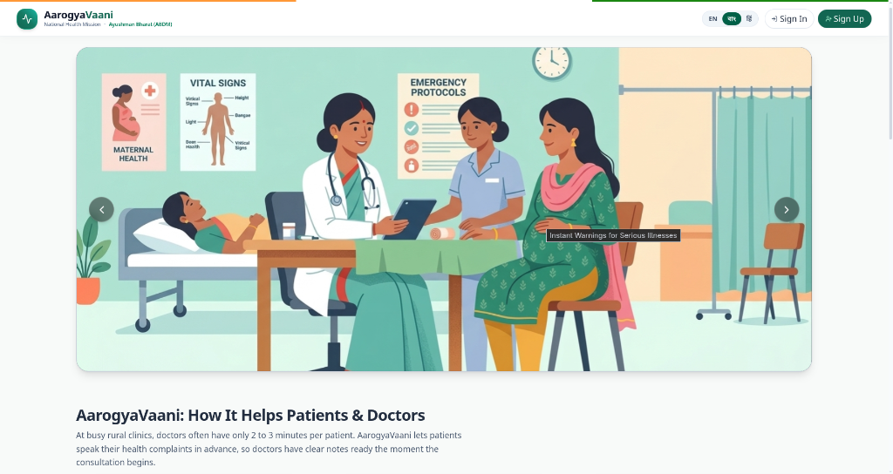

# AarogyaVaani (आरोग्यवाणी / আরোগ্যবাণী)

> **Voice-First Vernacular Clinical Intake & Offline Healthcare Triage Portal for Primary Health Centres (PHCs) in Tripura**  
> _Built for Hack for Social Good 2026 • Powered by LiveKit, Sarvam AI, Google Gemini, Groq, and Supabase Cloud_


-FF9900)


<br/>

**Voice-First Vernacular Clinical Intake & Offline Healthcare Triage Portal for Rural Primary Health Centres (PHCs) in Tripura**  
*Built for Hack for Social Good 2026*

<br/>

<p align="center">
  
</p>

<br/>

**[Features](#-key-features)** • **[Quick Start](#-quick-start)** • **[Architecture](#-architecture)** • **[Environment Variables](#-environment-variables)** • **[Design Doc](docs/TECHNICAL_DESIGN_DOCUMENT.md)** • **[Test Cases](docs/TEST_CASES_AND_VALIDATION.md)**

- 📘 **[Complete System Architecture & API Reference Manual](docs/SYSTEM_ARCHITECTURE_AND_API_REFERENCE.md)**  
  _Detailed guide covering all 18+ REST endpoints, WebRTC Voice Agent internals, Frontend wiring maps, and teammate quick-start instructions._
- 🔑 **[Credentials, Environment Variables & Git Push Guide](docs/CREDENTIALS_AND_PUSH_GUIDE.md)**  
  _Full reference for all API keys, `.env.example` setup, security ignore rules, and step-by-step GitHub push instructions._

---

## 📌 Executive Summary & Problem Statement

In rural Primary Health Centres (PHCs) across Tripura and northeastern India, medical officers face extreme outpatient density:
* **Severe Time Bottleneck:** Doctor consultation times are frequently constrained to **under 2 to 3 minutes per patient**.
* **Language & Literacy Barriers:** Patients primarily speak Bengali, Kokborok, or regional Hindi dialects, struggling with complex digital forms.
* **Fragmented Paper Records:** Patients arrive carrying crumpled plastic bags filled with disorganized paper prescriptions, laboratory reports, and physical X-ray film sheets.

**AarogyaVaani** bridges this first-mile clinical gap with a self-service, voice-interactive kiosk platform:
1. **Vernacular Voice Clinical Intake:** Elicits chief complaints, symptom duration, vitals, and red flags in natural spoken Bengali, Hindi, or English.
2. **Medical Drive & Vision OCR:** Scans and extracts structured clinical entities from doctor prescriptions, CBC pathology blood panels, and Chest X-Rays using Google Gemini Vision AI.
3. **Automated SOAP Clinical Dossiers:** Automatically drafts structured Subjective-Objective-Assessment-Plan (SOAP) clinical notes.
4. **Doctor Triage & Decision Support:** Delivers a prioritized queue (Red/Yellow/Green) and an intuitive Doctor Dashboard with a secure **Slide-to-Confirm** prescription approval workflow.

---

This single command boots up:

1. **FastAPI Backend Server** (`http://localhost:8001`) • Interactive API Docs at `http://localhost:8001/docs`
2. **LiveKit Voice Agent Worker** (`ai_service`) • Real-time Indic speech (Bengali, Hindi, English) with Sarvam AI & Groq
3. **React Vite Frontend** (`http://localhost:5173`) • Vernacular clinical intake, Medical Drive, and Doctor Dashboard

---

## 🏗️ Architecture

```
                      ┌────────────────────────────────────────┐
                      │          React Vite Frontend           │
                      │         (http://localhost:5173)        │
                      └──────────────┬──────────────────┬──────┘
                                     │                  │
                         HTTP REST   │                  │ WebRTC Stream &
                         Requests    │                  │ Data Channel
                                     ▼                  ▼
┌────────────────────────────────────────┐          ┌────────────────────────────────────────┐
│             FastAPI Server             │          │       LiveKit AI Voice Agent           │
│        (http://localhost:8001)         │          │              (ai_service)              │
│                                        │          │                                        │
│ • Phone + PIN Auth (/api/auth)         │          │ • Silero Edge VAD (Voice Detection)    │
│ • Medical Drive Vault (/api/documents) │          │ • Sarvam AI Indic STT (Saarika v2.5)   │
│ • Gemini Flash Vision Analyzers        │◄─────────┤ • Groq Fast Clinical Reasoning LLM     │
│ • LiveKit Token & Agent Dispatch       │   Sync   │ • Sarvam AI Indic TTS (Bulbul v3)      │
│ • Doctor EMR Review & Approval         │  Turns   │ • Supabase Realtime Clinical Sync      │
└───────────────────┬────────────────────┘          └───────────────────┬────────────────────┘
                    │                                                   │
                    └─────────────────────┬─────────────────────────────┘
                                          │
                                          ▼
                      ┌────────────────────────────────────────┐
                      │             Supabase Cloud             │
                      │  • PostgreSQL: patients, records,      │
                      │                consultations           │
                      │  • Storage: private 'medical-vault'    │
                      └────────────────────────────────────────┘
```

> 📘 **For deep architectural diagrams and sequence flows, inspect the [Technical Design Document](docs/TECHNICAL_DESIGN_DOCUMENT.md).**

---

## ⚡ Quick Start (Launch Everything in 1 Command)

AarogyaVaani includes orchestration scripts that boot all three services concurrently:

### Linux / macOS:
```bash
chmod +x start_all.sh
./start_all.sh
```

### Windows (PowerShell or Command Prompt):
```powershell
.\start_all.ps1
# Or double-click: start_all.bat
```

Once launched, access:
* **Patient Kiosk & Doctor Portal:** `http://localhost:5173`
* **FastAPI Backend Server:** `http://localhost:8001`
* **Interactive API Swagger Docs:** `http://localhost:8001/docs`

---

## 🛠️ Manual Step-by-Step Setup

If you prefer launching each service individually in separate terminals:

### 1. Prerequisites
* **Node.js:** `>= 18.0.0` & `npm`
* **Python:** `>= 3.11` (or `uv` package manager)
* Active API keys for **LiveKit Cloud**, **Sarvam AI**, **Groq**, **Google Gemini**, and **Supabase**.

---

### 2. Backend Server Setup (`server/`)
```bash
cd server

# Create virtual environment and activate
python3 -m venv .venv
source .venv/bin/activate    # On Windows: .venv\Scripts\activate

# Install dependencies
pip install -r requirements.txt

# Configure environment variables
cp .env.example .env
# Edit .env with your credentials

# Launch FastAPI server
python -m uvicorn app.main:app --host 0.0.0.0 --port 8001 --reload
```

---

### 3. Voice Agent Worker Setup (`ai_service/`)
```bash
cd ai_service

# Install dependencies using uv or pip
uv sync || pip install -r requirements.txt

# Configure environment variables
cp .env.example .env
# Edit .env with your credentials

# Start LiveKit Voice Agent worker
python agent.py dev
```

---

### 4. Frontend Client Setup (`client/`)
```bash
cd client

# Install dependencies
npm install

# Configure environment variables
cp .env.example .env

# Start Vite development server
npm run dev
```

---

## 🔑 Environment Variables Specification

Ensure your `.env` files are configured across the three services:

### 1. Backend Server (`server/.env`)
| Variable | Required | Default / Example | Purpose |
| :--- | :---: | :--- | :--- |
| `PROJECT_NAME` | No | `AarogyaVaani Medical Intelligence API` | API Title in Swagger |
| `HOST` | No | `0.0.0.0` | Binding host address |
| `PORT` | No | `8001` | Server listening port |
| `DATABASE_URL` | Yes | `sqlite:///./aarogya.db` | Local SQLite fallback DB |
| `GEMINI_API_KEY` | **Yes** | `AIzaSy...` | Google Gemini 2.5 Flash for Prescription & X-Ray OCR |
| `OPENAI_API_KEY` | **Yes** | `gsk_...` | Groq Cloud API Key for clinical LLM reasoning |
| `OPENAI_BASE_URL`| **Yes** | `https://api.groq.com/openai/v1` | Groq OpenAI-compatible endpoint |
| `LIVEKIT_URL` | **Yes** | `wss://your-project.livekit.cloud` | LiveKit WebRTC Cloud WebSocket |
| `LIVEKIT_API_KEY`| **Yes** | `APIdemo123...` | LiveKit API Key for room token generation |
| `LIVEKIT_API_SECRET`| **Yes** | `secret123...` | LiveKit API Secret |
| `SUPABASE_URL` | **Yes** | `https://xyz.supabase.co` | Supabase Cloud instance URL |
| `SUPABASE_PUBLISHABLE_KEY` | **Yes** | `eyJhbGci...` | Supabase Anon Key |
| `SUPABASE_SECRET_KEY` | **Yes** | `eyJhbGci...` | Supabase Service Role Key |

---

### 2. AI Voice Worker (`ai_service/.env`)
| Variable | Required | Default / Example | Purpose |
| :--- | :---: | :--- | :--- |
| `LIVEKIT_URL` | **Yes** | `wss://your-project.livekit.cloud` | WebRTC SFU Server |
| `LIVEKIT_API_KEY`| **Yes** | `APIdemo123...` | LiveKit Worker Key |
| `LIVEKIT_API_SECRET`| **Yes** | `secret123...` | LiveKit Worker Secret |
| `SARVAM_API_KEY` | **Yes** | `sarvam_...` | Sarvam AI Indic STT (`Saarika`) & TTS (`Bulbul v3`) |
| `OPENAI_API_KEY` | **Yes** | `gsk_...` | Groq Cloud Key for rapid Indic clinical prompt generation |
| `OPENAI_BASE_URL`| **Yes** | `https://api.groq.com/openai/v1` | Groq endpoint |
| `GEMINI_API_KEY` | **Yes** | `AIzaSy...` | Gemini Multimodal vision fallback |
| `SUPABASE_URL` | **Yes** | `https://xyz.supabase.co` | Supabase database instance |
| `SUPABASE_SECRET_KEY` | **Yes** | `eyJhbGci...` | Service role key for real-time EMR persistence |

---

### 3. Frontend Client (`client/.env`)
| Variable | Required | Default / Example | Purpose |
| :--- | :---: | :--- | :--- |
| `VITE_API_URL` | **Yes** | `http://localhost:8001/api` | Backend REST API endpoint |
| `VITE_LIVEKIT_URL` | **Yes** | `wss://your-project.livekit.cloud` | LiveKit WebRTC WebSocket URL |
| `VITE_SUPABASE_URL` | **Yes** | `https://xyz.supabase.co` | Supabase Client URL |
| `VITE_SUPABASE_ANON_KEY` | **Yes** | `eyJhbGci...` | Supabase Anonymous Client Key |

---

## 📡 Core API Reference

| Method | Endpoint | Description |
| :--- | :--- | :--- |
| `POST` | `/api/auth/register` | Register a new patient with Phone & 4-digit PIN |
| `POST` | `/api/auth/login` | Authenticate patient; returns JWT bearer token |
| `GET` | `/api/auth/me` | Fetch authenticated patient profile & ABHA ID |
| `POST` | `/api/livekit/token` | Generate WebRTC room token for voice consultation |
| `POST` | `/api/documents/upload` | Upload medical scan to Supabase storage & run Gemini Vision OCR |
| `GET` | `/api/documents/patient/{id}`| List all digitized records with signed preview URLs |
| `GET` | `/api/doctor/queue` | Retrieve prioritized doctor triage OPD queue (Red/Yellow/Green) |
| `POST` | `/api/doctor/consultations/{id}/approve` | Finalize clinical SOAP notes and approve prescription |

---

## 🧪 Testing & Validation

Execute the automated test suites:

```bash
# 1. Backend REST routes & medical analysis tests
cd server && PYTHONPATH=. .venv/bin/pytest -v

# 2. Voice agent Indic language & prompt tests
cd ai_service && uv run pytest -v

# 3. Frontend production build validation
cd client && npm run build
```

> 📊 **Explore sample patient profiles and test scenarios in [`sample_data/`](sample_data/) and [`docs/TEST_CASES_AND_VALIDATION.md`](docs/TEST_CASES_AND_VALIDATION.md).**

---

## 📂 Project Structure

```
Aarogya_vaani/
├── client/                     # React 19 + Vite Frontend SPA
│   ├── src/
│   │   ├── components/         # LiveVoiceAssistant, SlideToConfirm, DoctorHeader
│   │   ├── pages/              # PatientDashboard, DoctorDashboard, Login
│   │   └── services/           # Supabase client & REST API connectors
├── server/                     # FastAPI Backend Microservice
│   ├── app/
│   │   ├── api/                # Auth, Documents, LiveKit, Doctor CDS endpoints
│   │   ├── services/           # Gemini Vision, Groq reasoning, Supabase DB
│   │   └── models/             # Pydantic schemas & data entities
│   └── tests/                  # Automated pytest integration test suite
├── ai_service/                 # LiveKit Real-Time Indic Voice Agent Worker
│   ├── agent.py                # Silero VAD + Sarvam STT/TTS + Groq pipeline
│   └── orchestrator_client.py  # Realtime turn-taking & Supabase state persistence
├── sample_data/                # Synthetic test records for hackathon evaluation
│   ├── sample_patients.json
│   ├── sample_consultations.json
│   └── sample_documents.json
├── docs/                       # Technical Documentation
│   ├── TECHNICAL_DESIGN_DOCUMENT.md
│   ├── TEST_CASES_AND_VALIDATION.md
│   └── CREDENTIALS_AND_PUSH_GUIDE.md
├── start_all.sh                # 1-click Linux/macOS launcher
├── start_all.bat               # 1-click Windows CMD launcher
├── start_all.ps1               # 1-click Windows PowerShell launcher
└── LICENSE                     # MIT Open Source License
```

---

## 🏆 Hackathon Submission Details

* **Hackathon:** Hack for Social Good 2026
* **Team:** AarogyaVaani Engineering Group
* **License:** [MIT License](LICENSE)
