# AarogyaVaani Clinical Orchestrator: Hackathon-Ready Implementation Plan

> **Role**: Senior Full-Stack Engineer & AI Systems Architect  
> **Database Rule**: **Supabase PostgreSQL & Supabase Storage ONLY** (Zero SQLite, zero local JSON DBs).  
> **Preservation**: Retain existing Gemini Vision analyzer, LiveKit Voice Agent stack (Sarvam STT/TTS, Groq LLM, Silero VAD, Bengali/Hindi/English language management), and React UI design tokens.  
> **Security Model**: Cryptographic UUIDs for database relations + human-friendly clinical patient references (`AV-2026-8921`) + private Supabase Storage with expiring signed URLs for evidence sharing.  
> **Methodology**: Gated sequential phases where each phase is implemented and verified with automated tests before advancing.

---

## 1. Current Status & Verification Checkpoint

| Component | Status | Details |
| :--- | :--- | :--- |
| **Supabase PostgreSQL Schema** | ✅ **VERIFIED** | Tables `patients`, `medical_records`, `consultations` created in Supabase Cloud (`xsfucnrhjgzmdqlvnztu`). |
| **Supabase Storage Vault** | ✅ **VERIFIED** | Private bucket `medical-vault` created and verified private. |
| **Seeded Patients** | ✅ **VERIFIED** | `AV-2026-8921` (Mamta Debbarma) and `AV-2026-9012` (Bimala Reang) seeded and queryable. |
| **Phase 1 Test Suite** | ✅ **VERIFIED** | `test_phase1_supabase.py` passed 3/3 tests (100% green). |

---

## 2. System Architecture & End-to-End Data Flow

```mermaid
flowchart TB
    subgraph Client["Web Client (React 19 / Vite 8)"]
        UI_Vault["Medical Drive UI\n(Search by Title/Date, Preview, Download Signed URLs)"]
        UI_Voice["Voice Consultation UI\n(LiveKit WebRTC Audio Stream)"]
        UI_Doctor["Doctor Review Portal\n(Review Voice Triage, Transcripts & Approved Rx)"]
    end

    subgraph Server["FastAPI API Gateway (:8001)"]
        DocRoutes["/api/documents & /api/prescriptions\n/api/xray-radiology"]
        OrchRoutes["/api/orchestrator\n(Dossier Builder & Consultation Sync)"]
        LKRoutes["/api/livekit/token\n(WebRTC Room Token with Patient Identity)"]
        GeminiService["Google Gemini Vision AI\n(OCR, Structured Meds, Multilingual Summaries)"]
        SupaDriver["Supabase Driver\n(PostgREST + Storage Signed URLs)"]
    end

    subgraph Supabase["Supabase Cloud Infrastructure"]
        Storage["Private Storage: 'medical-vault'\n/{patient_ref}/{filename}"]
        T_Patients[("Table: patients\n(UUID, Ref: AV-2026-8921, Name, ANC Stage)")]
        T_Records[("Table: medical_records\n(Title, Visit Date, Storage Path, Structured Meds, AI Summaries)")]
        T_Consults[("Table: consultations\n(Voice Transcripts, Red Flags, Triage Notes)")]
    end

    subgraph AIService["LiveKit Voice Worker (:ai_service)"]
        AgentWorker["agent.py (LiveKit RTC Worker)"]
        LangMgr["language_manager.py (Bengali/Hindi/English Lock)"]
        SafetyRules["rules/danger_signs.py (Deterministic Red-Flag Guard)"]
        MedicalTools["tools/medical_tools.py (LLM Function Tools for Meds & Scans)"]
        OrchClient["orchestrator_client.py (Async HTTP to :8001)"]
    end

    %% Document Upload & Drive
    UI_Vault -->|"1. Upload Scan + Title + Date"| DocRoutes
    DocRoutes -->|"2. Stream binary"| Storage
    DocRoutes -->|"3. OCR & Multilingual Extraction"| GeminiService
    DocRoutes -->|"4. Persist Record with AI Summary"| T_Records
    UI_Vault -->|"5. Search by Title/Date & View Evidence"| DocRoutes
    DocRoutes -->|"6. Generate 15-min Signed URL"| Storage

    %% Voice Intake & Orchestration
    UI_Voice -->|"7. Request Token (AV-2026-8921)"| LKRoutes
    LKRoutes -->|"8. WebRTC JWT"| UI_Voice
    UI_Voice <-->|"9. Bidirectional Audio (WebRTC)"| AgentWorker
    AgentWorker -->|"10. GET /api/orchestrator/patient/{ref}/dossier"| OrchRoutes
    OrchRoutes -->|"11. Query Patient + Prescriptions + X-Rays"| Supabase
    AgentWorker -->|"12. Greet by Name & Answer Med Queries"| UI_Voice
    AgentWorker -->|"13. POST Consultation Summary & Transcript"| OrchRoutes
    OrchRoutes -->|"14. Save Transcript & Danger Flags"| T_Consults

    %% Doctor Access
    UI_Doctor -->|"15. Fetch Consultation Transcripts & Records"| Server
    Server --> Supabase
```



---

## 3. Patient Identity & Security Architecture (Hackathon-Ready)

1. **Dual Identifier Design**:
   - **Internal Primary Key (`id` UUID)**: Used for database foreign key constraints and prevents enumeration attacks.
   - **Clinical Patient Reference (`patient_ref`)**: Human-readable identifier (e.g. `AV-2026-8921`). Spoken naturally by the voice agent, printed on receipts, and easily entered in the UI.
2. **Private Medical Evidence Vault (Google Drive-Style)**:
   - Supabase Storage bucket `medical-vault` is strictly **private**.
   - No permanent public URLs exist.
   - Frontend accesses files strictly via **15-minute signed URLs** generated on-the-fly (`supabase.storage.from_("medical-vault").create_signed_url(path, 900)`).
3. **Audit Trail & Doctor Evidence**:
   - Every document record stores `title`, `visit_date`, `category`, `storage_path`, `structured_data` (exact dosage/frequency), and `summary_en`, `summary_hi`, `summary_bn`.
   - Patients and doctors can filter and search by date or title to review evidence at any time.

---

## 4. Phased Implementation Roadmap

```mermaid
gantt
    title AarogyaVaani Phased Implementation Roadmap
    dateFormat  X
    axisFormat  Phase %d
    section DB
    Phase 1: Supabase Foundation (DONE)          :done, p1, 0, 1
    section AI Vision & Drive
    Phase 2: Gemini Document Persistence & Drive :active, p2, 1, 2
    section Voice Agent
    Phase 3: LiveKit Voice Agent Direct Sync     :p3, 2, 3
    section Orchestration
    Phase 4: Unified Clinical Orchestrator       :p4, 3, 4
    section Frontend
    Phase 5: React Medical Drive & Voice UI      :p5, 4, 5
    section Verification
    Phase 6: End-to-End Live Hackathon Rehearsal :p6, 5, 6
```

---

### Phase 1 — Supabase Foundation & Database Setup (COMPLETED ✅)

- **Completed Deliverables**:
  - `server/app/db/migrations/001_initial_schema.sql` executed in Supabase SQL Editor.
  - Tables `patients`, `medical_records`, `consultations` created with indexes and RLS.
  - Private Supabase Storage bucket `medical-vault` created.
  - `server/app/db/supabase_client.py` created with helper utilities.
  - `server/app/db/seed_supabase.py` successfully seeded demo patients `AV-2026-8921` (Mamta Debbarma) and `AV-2026-9012` (Bimala Reang).
  - Automated test `server/tests/test_phase1_supabase.py` passed 3/3 tests (100% green).

---

### Phase 2 — Gemini Document Intelligence & Medical Drive Persistence

#### 1. Objective
Enable uploading of prescriptions, lab reports, and chest X-rays to Supabase Storage `medical-vault`, analyze them using Google Gemini Vision AI, persist the extracted clinical data and multilingual summaries into Supabase `medical_records`, and provide searchable, shareable signed URLs (Medical Drive).

#### 2. Key Requirements
- **Searchable Metadata**: Store user-friendly `title`, `visit_date`, `category`, and `file_name`.
- **Gemini Vision Extraction**: Extract drugs, dosages, timing, flagged lab parameters, and radiology impressions.
- **Multilingual Summaries**: Persist `summary_en`, `summary_hi`, `summary_bn` directly in the database row for voice retrieval and UI display.
- **Storage Driver**: Stream uploads directly into `medical-vault/{patient_ref}/{file_id}_{filename}` and return temporary signed URLs.
- **Search & Filter API**: `GET /api/documents/patient/{patient_id}?title=...&category=...&visit_date=...`.

#### 3. Files to Modify / Create
- **Modify**: `server/app/services/storage_service.py` — Replace local disk saving with Supabase Storage upload and signed URL generator.
- **Modify**: `server/app/api/documents.py` — Replace SQLite insertions with Supabase `medical_records` inserts and add search queries.
- **Modify**: `server/app/api/prescriptions.py` & `server/app/api/xray_radiology.py` — Point to Supabase `medical_records`.
- **Create**: `server/tests/test_phase2_document_persistence.py` — Automated test suite verifying file upload, Gemini OCR, Supabase row insertion, and search by title/date.

#### 4. Verification Gate
```bash
cd "/home/bappaditya/coding/2026 Projects/hack for social2/Aarogya_vaani/server"
.venv/bin/python -m pytest tests/test_phase2_document_persistence.py -v
```
- **Acceptance Criteria**: Sample prescription and X-ray upload successfully, Gemini extracts medicines, records appear in Supabase `medical_records`, and signed URLs open the files.

---

### Phase 3 — LiveKit Voice Agent Verification & Consultation Persistence

#### 1. Objective
Verify the existing voice agent (`ai_service/agent.py`) without disrupting its working audio pipeline (Sarvam STT/TTS, Groq LLM, Silero VAD, Bengali/Hindi/English locking), and integrate direct Supabase persistence so every voice consultation (full transcript turns, symptoms timeline, danger flags, and triage level) is saved to the `consultations` table.

#### 2. Key Requirements
- **Preserve Voice Pipeline**: Keep Sarvam AI (`bn-IN`, `hi-IN`, `en-IN`), Groq fast LLM reasoning, Silero VAD, and `language_manager.py`.
- **Accumulate Transcripts**: Track user and agent speech turns with timestamps during the call.
- **Deterministic Red-Flag Evaluation**: Run `ai_service/rules/danger_signs.py` at call conclusion.
- **Consultation Persistence**: Send structured consultation payload to FastAPI `POST /api/orchestrator/consultations` which inserts the row into Supabase `consultations`.

#### 3. Files to Modify / Create
- **Create**: `server/app/api/orchestrator.py` — Router with `POST /api/orchestrator/consultations` to insert consultation sessions into Supabase.
- **Modify**: `server/app/main.py` — Register orchestrator router.
- **Create**: `ai_service/orchestrator_client.py` — Async HTTP client to sync sessions with backend.
- **Modify**: `ai_service/agent.py` — Add conversation logging and trigger background consultation save on room disconnect.
- **Create**: `server/tests/test_phase3_consultation_persistence.py` — Automated test validating consultation persistence in Supabase.

#### 4. Verification Gate
```bash
cd "/home/bappaditya/coding/2026 Projects/hack for social2/Aarogya_vaani/server"
.venv/bin/python -m pytest tests/test_phase3_consultation_persistence.py -v
```
- **Acceptance Criteria**: Simulated voice consultation transcript lands in Supabase `consultations` table with assigned triage level (`STABLE`, `MONITOR`, `EMERGENCY`).

---

### Phase 4 — Unified Clinical Orchestrator (Connecting Voice Agent + Gemini Intelligence)

#### 1. Objective
Build the clinical orchestrator that bridges Gemini document intelligence and the LiveKit voice agent: when a patient enters a voice call, the agent retrieves their complete clinical dossier from Supabase (past prescriptions, active medicines, lab reports, X-rays), greets them by name, and uses LLM function tools to accurately answer their questions about their medicines.

#### 2. Key Requirements
- **Clinical Dossier Endpoint**: `GET /api/orchestrator/patient/{patient_ref}/dossier` compiles:
  - Patient demographics (name, age, village, ANC stage, allergies).
  - Active medications list (name, dosage, frequency, instructions, prescribing doctor).
  - Recent diagnostic findings (X-ray impressions, flagged lab values).
  - Last consultation notes and danger sign history.
- **Personalized Voice Greeting**: Agent greets the patient naturally: *"নমস্কার মমতা দেবী, আশা করি আপনি ভালো আছেন..."* / *"Namaste Mamta Devi..."*.
- **Medical Function Tools**: Register LLM tools in `ai_service/agent.py`:
  - `check_prescription_medicines()`: Inquires dosage and timing from verified records.
  - `check_xray_findings()`: Reads imaging impressions.
  - `check_lab_results()`: Reads pathology values.
- **Anti-Hallucination Guardrail**: The agent strictly cites verified Supabase records and advises clinical review if information is missing.

#### 3. Files to Modify / Create
- **Modify**: `server/app/api/orchestrator.py` — Add `GET /api/orchestrator/patient/{patient_ref}/dossier`.
- **Create**: `ai_service/tools/medical_tools.py` — Function tools registered with LiveKit LLM.
- **Modify**: `ai_service/agent.py` — Ingest dossier upon participant connection and attach function tools.
- **Create**: `server/tests/test_phase4_orchestrator.py` — Automated verification of dossier generation and tool execution.

#### 4. Verification Gate
```bash
cd "/home/bappaditya/coding/2026 Projects/hack for social2/Aarogya_vaani/server"
.venv/bin/python -m pytest tests/test_phase4_orchestrator.py -v
```
- **Acceptance Criteria**: Dossier compiles real Supabase records for `AV-2026-8921`, agent generates personalized system prompt, and medical tools return verified medication advice.

---

### Phase 5 — Frontend Medical Drive & LiveKit Voice Consultation UI

#### 1. Objective
Connect the React/Vite client to the live FastAPI backend: enable file uploads to the Supabase Medical Drive, search by title and date, view/download evidence via short-lived signed URLs, view AI-extracted multilingual summaries, and initiate LiveKit voice consultations with live patient identity.

#### 2. Key Requirements
- **Medical Drive UI (`PatientDocumentsPage.jsx`)**:
  - File upload with title, category, and date inputs.
  - Filter by category and search by title or date.
  - Preview card displaying extracted medicines and Bengali/Hindi/English summary tabs.
  - "View / Share Evidence" button opening signed URL in new tab.
- **Doctor Review Dashboard (`DoctorReviewTab.jsx`)**:
  - Displays pending consultations, full voice transcripts, and flagged danger signs.
  - Displays patient's verified document drive.
- **Live Voice Consultation (`LiveVoiceAssistant.jsx` / `PatientAIDoctorPage.jsx`)**:
  - Requests LiveKit token with patient reference (`AV-2026-8921`).
  - Audio visualizer connects to LiveKit Cloud room.

#### 3. Files to Modify / Create
- **Create**: `client/src/services/api.js` — Unified client SDK for FastAPI endpoints.
- **Modify**: `client/src/pages/PatientDashboard/PatientDocumentsPage.jsx` — Connect to `api.js` (replacing `localStorage`).
- **Modify**: `client/src/pages/DoctorDashboard/DoctorReviewTab.jsx` — Connect to Supabase consultation and record endpoints.
- **Modify**: `client/src/components/LiveVoiceAssistant.jsx` — Wire room token generation with selected patient.

#### 4. Verification Gate
```bash
cd "/home/bappaditya/coding/2026 Projects/hack for social2/Aarogya_vaani/client"
npm run build
```
- **Acceptance Criteria**: Client builds cleanly with zero errors, uploads appear in Supabase Storage and Table Editor, and refreshing the page preserves all documents.

---

### Phase 6 — End-to-End Live Hackathon Rehearsal & Demo Runbook

#### 1. Objective
Execute the full hackathon demonstration rehearsal from end to end, verifying data isolation, error recovery, and seamless clinical handoff between patient, voice agent, and doctor.

#### 2. Hackathon Demo Script & Verification Flow
1. **Document Intake (Drive)**:
   - Patient `AV-2026-8921` uploads handwritten prescription scan titled *"Dr. Sengupta ANC Visit"*.
   - Gemini Vision AI extracts medicines (Iron, Calcium, Folvite) and multilingual summaries.
   - Record is stored in Supabase `medical_records` and file in `medical-vault`.
2. **Medical Drive Search & Evidence Sharing**:
   - Filter documents by date or search *"Sengupta"*.
   - Click "View Evidence" to demonstrate private signed URL security.
3. **Voice Consultation (AarogyaVaani Assistant)**:
   - Patient starts voice call in Bengali or Hindi.
   - Agent greets: *"নমস্কার মমতা দেবী (Mamta Devi)..."*.
   - Patient asks: *"আমি কোন কোন ওষুধ খাব?"* ("Which medicines should I take?").
   - Voice agent retrieves the verified prescription from Supabase and answers accurately.
   - Patient mentions headache and dizziness -> Danger sign engine evaluates preeclampsia risk -> Triage status set to `MONITOR`.
4. **Doctor Review & Closure**:
   - Doctor opens portal, reviews the conversation transcript, confirms the flagged symptoms, and approves the consultation summary.
   - Session marked `REVIEWED` in Supabase.

#### 3. Verification Gate
```bash
cd "/home/bappaditya/coding/2026 Projects/hack for social2/Aarogya_vaani/server"
.venv/bin/python -m pytest tests/ -v
```
- **Acceptance Criteria**: 100% of test suites across all phases pass cleanly against live Supabase Cloud.

---

## 5. Implementation Priority Matrix

| Phase | Core Objective | Key Deliverables | Estimated Effort |
| :--- | :--- | :--- | :--- |
| **Phase 1** | Supabase Foundation | Tables, bucket, seeded demo patients | **DONE (Verified)** |
| **Phase 2** | Gemini Document Drive | Supabase Storage stream, Vision OCR, signed URLs, title/date search | **NEXT IMMEDIATE STEP** |
| **Phase 3** | Voice Agent Sync | Consultation saving, transcript logging, red-flag triage | Follows Phase 2 |
| **Phase 4** | Clinical Orchestrator | Patient dossier builder, personalized greeting, LLM medical tools | Follows Phase 3 |
| **Phase 5** | Frontend Drive & UI | React integration, search/filter, signed URL preview, LiveKit token | Follows Phase 4 |
| **Phase 6** | E2E Live Rehearsal | Full hackathon demonstration test across all components | Final validation |
