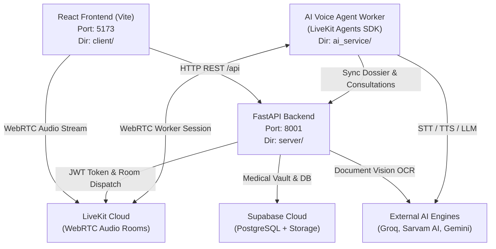

# AarogyaVaani — Credentials, Environment Variables & Git Push Guide

This document is the definitive reference for development team members, judges, and contributors to configure credentials across all services, safely manage secrets, and push project updates to GitHub without accidental token leaks.

---

## 1. Project Component Map & Port Architecture

AarogyaVaani consists of three core components running in harmony:



---

## 2. Complete Credential & Environment Variable Catalog

Each service has its own `.env` file (copied from `.env.example`). Below is the full breakdown of every credential, what it does, and where to obtain it.

### A. Frontend Client (`client/.env`)

Located in: `client/.env` (Template: `client/.env.example`)

| Variable Name | Description | Where to Obtain |
|---|---|---|
| `VITE_API_URL` | Base URL of the FastAPI backend server (default: `http://localhost:8001/api`). | Local backend server URL. |
| `VITE_LIVEKIT_URL` | WebSocket URL for LiveKit Cloud (e.g., `wss://your-project.livekit.cloud`). | [LiveKit Cloud Console](https://cloud.livekit.io/) > Project Settings > Keys. |
| `VITE_SUPABASE_URL` | Public HTTPS endpoint of your Supabase Cloud instance. | [Supabase Dashboard](https://supabase.com/dashboard) > Project Settings > API > Project URL. |
| `VITE_SUPABASE_ANON_KEY` | Public anonymous publishable key for Supabase authentication and client queries. | [Supabase Dashboard](https://supabase.com/dashboard) > Project Settings > API > `anon` `public` key. |
| `SUPABASE_URL` | Fallback alias for `VITE_SUPABASE_URL`. | Same as `VITE_SUPABASE_URL`. |
| `SUPABASE_PUBLISHABLE_KEY` | Fallback alias for `VITE_SUPABASE_ANON_KEY`. | Same as `VITE_SUPABASE_ANON_KEY`. |

---

### B. Backend Server (`server/.env`)

Located in: `server/.env` (Template: `server/.env.example`)

| Variable Name | Description | Where to Obtain |
|---|---|---|
| `PROJECT_NAME` | Project name displayed in OpenAPI Swagger docs (default: `"AarogyaVaani Medical Intelligence API"`). | Internal config. |
| `VERSION` | API release version (e.g., `"1.0.0"`). | Internal config. |
| `API_PREFIX` | Base route prefix (default: `"/api"`). | Internal config. |
| `HOST` | Bind address (default: `"0.0.0.0"`). | Internal config. |
| `PORT` | HTTP port for FastAPI (default: `8001`). | Internal config. |
| `UPLOAD_DIR` | Local storage directory for file caching (default: `"uploads"`). | Internal config. |
| `DATABASE_URL` | Local SQLite database fallback path (default: `"sqlite:///./aarogya.db"`). | Internal config. |
| `GEMINI_API_KEY` | **Google Gemini Vision API key**: Used for analyzing medical prescriptions, lab reports, and radiology X-ray images. | [Google AI Studio](https://aistudio.google.com/) > Get API Key. |
| `OPENAI_API_KEY` | **Groq Cloud API Key**: Powers fast LLM clinical inference, entity extraction, and OCR structuring. | [Groq Console](https://console.groq.com/keys) > Create API Key. |
| `OPENAI_BASE_URL` | Set to `https://api.groq.com/openai/v1` to route OpenAI-compatible requests through Groq. | Fixed value: `https://api.groq.com/openai/v1`. |
| `LIVEKIT_URL` | WebSocket URL for LiveKit Cloud (`wss://...`). | [LiveKit Cloud Console](https://cloud.livekit.io/) > Settings > Keys. |
| `LIVEKIT_API_KEY` | API Key used by FastAPI to generate patient room tokens and create agent dispatches. | [LiveKit Cloud Console](https://cloud.livekit.io/) > Settings > Keys. |
| `LIVEKIT_API_SECRET` | Secret key used to sign LiveKit WebRTC access tokens. | [LiveKit Cloud Console](https://cloud.livekit.io/) > Settings > Keys. |
| `SUPABASE_URL` | Supabase project URL (`https://<ref>.supabase.co`). | [Supabase Dashboard](https://supabase.com/dashboard) > Project Settings > API. |
| `SUPABASE_PUBLISHABLE_KEY` | Anon public key for Supabase client initialization. | [Supabase Dashboard](https://supabase.com/dashboard) > Project Settings > API. |
| `SUPABASE_SECRET_KEY` | **Service Role Key (Secret)**: Grants admin backend access to bypass RLS for patient records and uploads. | [Supabase Dashboard](https://supabase.com/dashboard) > Project Settings > API > `service_role` secret. |
| `SUPABASE_JWKS_URL` | URL to verify incoming Supabase user JWT tokens (`.../auth/v1/.well-known/jwks.json`). | Auto-derived from `SUPABASE_URL`. |

---

### C. AI Voice Service (`ai_service/.env`)

Located in: `ai_service/.env` (Template: `ai_service/.env.example`)

> **Note**: `ai_service` does **not** expose HTTP endpoints. It runs as an autonomous LiveKit Agents worker waiting for room connection jobs over WebRTC.

| Variable Name | Description | Where to Obtain |
|---|---|---|
| `LIVEKIT_URL` | WebSocket URL for LiveKit Cloud (`wss://...`). | [LiveKit Cloud Console](https://cloud.livekit.io/). |
| `LIVEKIT_API_KEY` | LiveKit API Key for the worker process to authenticate with the LiveKit room. | [LiveKit Cloud Console](https://cloud.livekit.io/). |
| `LIVEKIT_API_SECRET` | LiveKit Secret Key for worker authentication. | [LiveKit Cloud Console](https://cloud.livekit.io/). |
| `SARVAM_API_KEY` | **Sarvam AI API Key**: Powers Indic Speech-to-Text (`saarika:v2.5`) and Indian-accent Text-to-Speech (`bulbul:v3`) in Bengali, Hindi, and Indian English. | [Sarvam AI Dashboard](https://dashboard.sarvam.ai/) > API Keys. |
| `OPENAI_API_KEY` | **Groq Cloud API Key**: Used for ultra-low latency conversational intake reasoning (e.g. `openai/gpt-oss-120b` or `llama-3.3-70b-versatile`). | [Groq Console](https://console.groq.com/keys). |
| `OPENAI_BASE_URL` | `https://api.groq.com/openai/v1` (routes Groq LLM through standard OpenAI client). | Fixed value: `https://api.groq.com/openai/v1`. |
| `GEMINI_API_KEY` | Google Gemini API key for fallback document reasoning. | [Google AI Studio](https://aistudio.google.com/). |
| `SUPABASE_URL` | Supabase project URL for direct database access fallback. | [Supabase Dashboard](https://supabase.com/dashboard). |
| `SUPABASE_PUBLISHABLE_KEY`| Supabase public anon key. | [Supabase Dashboard](https://supabase.com/dashboard). |
| `SUPABASE_SECRET_KEY` | Supabase service role secret key. | [Supabase Dashboard](https://supabase.com/dashboard). |
| `ANTHROPIC_API_KEY` | *(Optional fallback)* Claude 3.5 Sonnet API key. | [Anthropic Console](https://console.anthropic.com/). |
| `ASSEMBLYAI_API_KEY` | *(Optional fallback)* AssemblyAI speech-to-text backup. | [AssemblyAI Dashboard](https://www.assemblyai.com/). |
| `CARTESIA_API_KEY` | *(Optional fallback)* Cartesia TTS audio engine backup. | [Cartesia Dashboard](https://play.cartesia.ai/). |

---

## 3. Git Security & Ignore Verification

To guarantee that private API keys and database files are **NEVER** pushed to GitHub:

1. **`.gitignore` Rules**:
   The root `.gitignore` ignores all `.env` variations:
   ```gitignore
   *.env
   .env
   .env.local
   .env.*.local
   !.env.example
   *.db
   *.sqlite
   *.sqlite3
   __pycache__/
   *.pyc
   ```
2. **Untracked Secret Files**:
   `client/.env`, `server/.env`, and `ai_service/.env` are strictly excluded from git tracking.
3. **Committed Example Templates**:
   Teammates and GitHub viewers will only see:
   - `client/.env.example`
   - `server/.env.example`
   - `ai_service/.env.example`

---

## 4. Step-by-Step Guide to Push to GitHub

Follow these exact steps from your terminal:

### Step 1: Open Terminal in Project Directory
```bash
cd "/home/bappaditya/coding/2026 Projects/hack for social2/Aarogya_vaani"
```

### Step 2: Check Git Status
```bash
git status
```
*Verify that `client/.env`, `server/.env`, and `ai_service/.env` do **NOT** appear in the output.*

### Step 3: Stage All Updated Files
```bash
git add .
```

### Step 4: Commit with a Clear Message
```bash
git commit -m "feat: complete live voice assistant fix, unified clinical intake, and API documentation"
```

### Step 5: Push to Remote Repository
```bash
git push origin main
```

> **Note on GitHub Authentication**:
> If prompted for your username and password:
> - **Username**: Your GitHub username (or token owner username).
> - **Password**: Use a **GitHub Personal Access Token (Classic)** with `repo` scope enabled from [GitHub Settings > Developer Settings > Personal Access Tokens](https://github.com/settings/tokens), NOT your personal account password.

---

## 5. How Teammates Clone and Run the Project

When a teammate clones this repository:

### 1. Clone the Repository
```bash
git clone https://github.com/Sayan-CtrlZ/Aarogya_vaani.git
cd Aarogya_vaani
```

### 2. Copy `.env.example` to `.env` in all 3 Services
```bash
# Frontend Client
cp client/.env.example client/.env

# Backend Server
cp server/.env.example server/.env

# AI Service
cp ai_service/.env.example ai_service/.env
```
*Fill in the real API keys in each of the three `.env` files.*

### 3. Install Dependencies
```bash
# 1. Client
cd client && npm install && cd ..

# 2. Server
cd server
python3 -m venv .venv
source .venv/bin/activate
pip install -r requirements.txt
deactivate && cd ..

# 3. AI Service
cd ai_service
uv sync  # or: python3 -m venv .venv && source .venv/bin/activate && pip install -r requirements.txt
cd ..
```

### 4. One-Command Launch All Services
```bash
chmod +x start_all.sh
./start_all.sh
```

This starts:
1. **FastAPI Backend**: `http://localhost:8001` (Interactive Swagger docs: `http://localhost:8001/docs`)
2. **LiveKit Voice Agent Worker**: Automatically connects to LiveKit Cloud room dispatcher
3. **React Web App**: `http://localhost:5173`

---

## 6. End-to-End Verification Checklist

After launching, perform this 60-second test:

1. Open `http://localhost:5173/patient/ai-doctor` in Chrome or Edge.
2. Ensure the top-right badge displays **`LIVEKIT WEBRTC ACTIVE`** with a green pulse dot.
3. Select your preferred consultation language (**English**, **বাংলা / Bengali**, or **हिन्दी / Hindi**).
4. Click **Start Live Consultation**.
5. The AI Doctor greets you with voice audio in your selected language!
6. Speak a symptom (e.g., *"I have had a mild headache since yesterday"*).
7. Notice the real-time waveform animation and clinical response in your chosen language.
8. Click **End Consultation & Review Summary**: check that the intake consultation summary is saved to Supabase and viewable in the Patient Dashboard.
