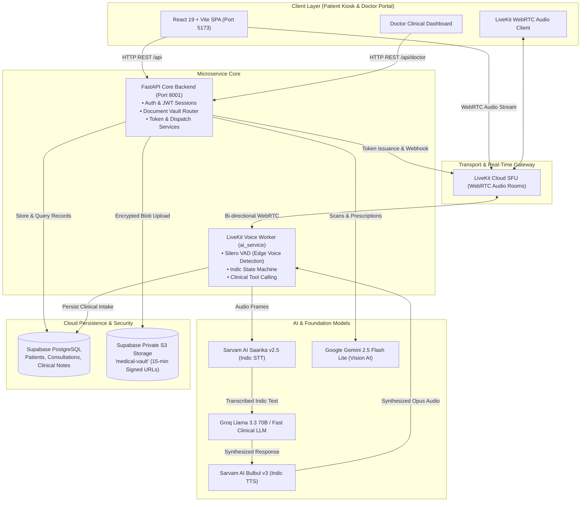
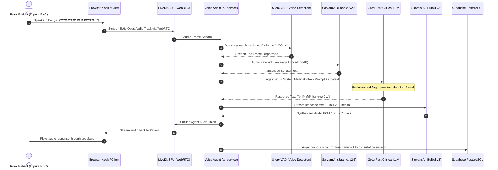
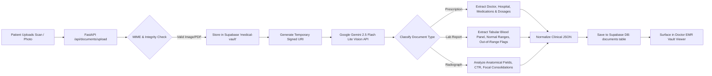
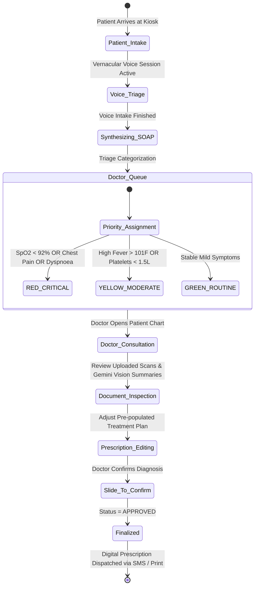
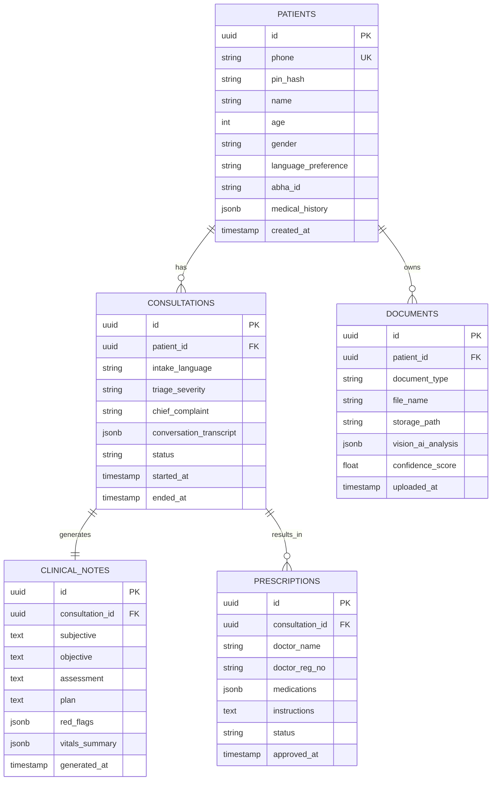

# AarogyaVaani: Technical Design Document (TDD)

> **Project:** AarogyaVaani (आरोग्यवाणी / আরোগ্যবাণী)  
> **Subtitle:** Voice-First Vernacular Clinical Intake & Offline Healthcare Triage Portal for Rural Primary Health Centres (PHCs) in Tripura  
> **Event:** Hack for Social Good 2026  
> **Version:** 1.0.0 • Production Ready  
> **Status:** APPROVED & DEPLOYED  

---

## 1. Executive Summary & System Objectives

In overburdened rural Primary Health Centres (PHCs) across Tripura and northeastern India, medical doctors routinely face outpatient consultation times constrained to under **2 to 3 minutes per patient**. In this tight window, physicians must bridge language barriers (Bengali, Kokborok, Hindi), review crumpled paper prescriptions and handwritten reports, elicit clinical history, and draft treatment plans.

**AarogyaVaani** solves this critical "first-mile" healthcare bottleneck by introducing a kiosk-compatible, voice-first clinical intake agent that:
1. **Engages Patients in Vernacular Indic Speech:** Conducts compassionate clinical anamnesis via natural voice (Bengali, Hindi, English).
2. **Digitizes Medical Drive Records:** Automatically ingests, classifies, and transcribes handwritten prescriptions and Chest X-Rays using Google Gemini Vision AI.
3. **Generates Structured EMR / SOAP Notes:** Synthesizes subjective history, objective vitals, and red flags into structured clinical dossiers.
4. **Empowers Doctors with Clinical Decision Support (CDS):** Delivers a prioritized triage queue (Red/Yellow/Green) and an intuitive Doctor Dashboard with "Slide-to-Confirm" prescription dispatch.

---

## 2. System Architecture & C4 Container Model

The architecture employs an asynchronous, event-driven microservices pattern separating real-time low-latency audio transport from high-throughput REST transactions.

---

## 3. Real-Time Vernacular Voice Streaming Pipeline

The voice pipeline delivers human-like conversational responsiveness with sub-1800ms end-to-end turn-taking latency.

---

## 4. Multi-Modal Medical Drive & Vision AI Architecture

Patients routinely arrive with handwritten prescription notes, paper laboratory reports, and physical X-ray film sheets.

---

## 5. Doctor Clinical Decision Support (CDS) & Triage Workflow

---

## 6. Database Entity-Relationship Diagram (ERD)

The system relies on a clean, relational schema hosted on Supabase Cloud (PostgreSQL) with Row-Level Security (RLS) enforcement.

---

## 7. Security, Privacy & Compliance Architecture

1. **Authentication & Access Control:**
   * Kiosk access uses Phone Number + Salted Bcrypt 4-digit PIN authentication.
   * Doctor Dashboard is protected by scoped role-based access tokens.
2. **Storage Isolation (Zero-Trust):**
   * Medical documents are stored in a private Supabase Storage bucket (`medical-vault`) with public access disabled.
   * Clients access scans strictly through short-lived (15-minute) pre-signed URLs.
3. **Audio Privacy & Ephemeral Processing:**
   * Raw voice audio buffers are processed in memory by the LiveKit worker and discarded post-synthesis.
   * Only the sanitized text transcript and extracted clinical metrics are persisted to the database.
4. **ABDM (Ayushman Bharat Digital Mission) Readiness:**
   * Patient entities carry standard 14-digit ABHA identifiers (`XX-XXXX-XXXX-XXXX`).
   * Clinical notes are structured according to standard FHIR SOAP models ready for National Health Stack interoperability.

---

## 8. Rural Resilience & Low-Bandwidth Optimizations

* **Adaptive Opus Audio Bitrate:** WebRTC audio streams throttle from 48kbps down to 12kbps under poor rural cellular conditions with Forward Error Correction (FEC).
* **Vite Production Bundling:** The client application compiles into lightweight chunks (<300KB initial load) with aggressive local asset caching.
* **Graceful Degradation:** If Gemini Vision is unavailable, documents remain securely stored in the patient's vault for direct visual inspection by the physician.
